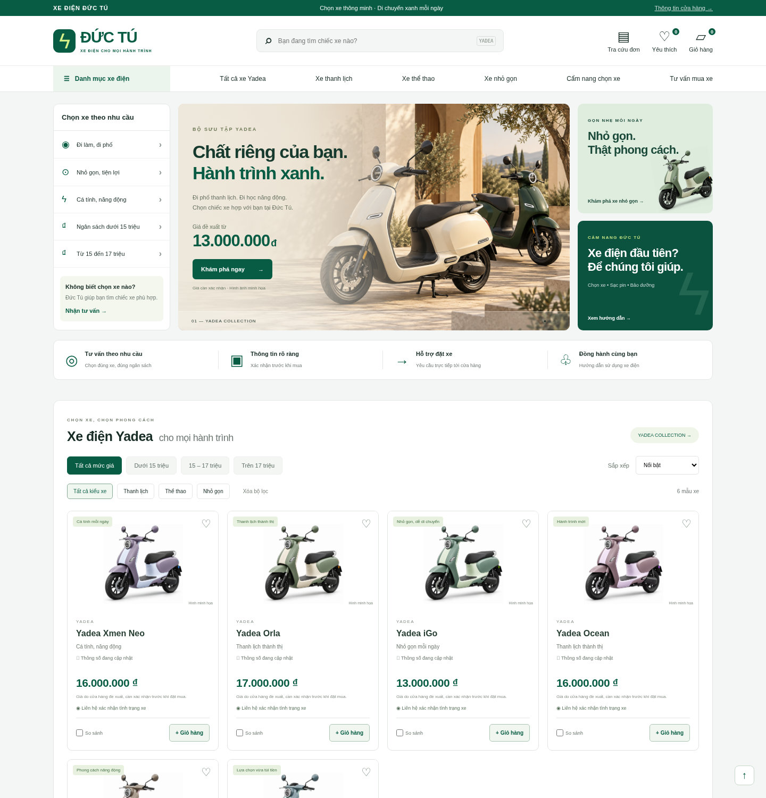

# Xe Điện Đức Tú

Website bán xe máy điện: giao diện tiếng Việt responsive, danh mục Yadea từ cơ sở dữ liệu, tìm kiếm/lọc ngân sách và kiểu xe/sắp xếp, chi tiết sản phẩm có đường dẫn chia sẻ, yêu thích, so sánh tối đa 3 xe, giỏ hàng, gửi yêu cầu đặt xe và tư vấn, tra cứu trạng thái bằng mã đơn + điện thoại, quản trị sản phẩm/chính sách/tồn kho/đơn hàng và xuất CSV. Node.js 24 và SQLite tích hợp, không cần thư viện bên ngoài.

## Chạy phát triển

Trên Windows: cài Node.js 24, giải nén mã nguồn và nhấp đúp `XEM-WEBSITE.cmd`, rồi mở `http://localhost:3000` trên chính máy đó. Giữ cửa sổ lệnh mở. Cách này tạo mật khẩu quản trị ngẫu nhiên cho phiên xem thử; để quản trị, tự đặt biến ADMIN_PASSWORD và chạy theo hướng dẫn bên dưới. Danh mục Yadea mặc định có thể xem ngay; nhận yêu cầu vẫn khóa khi thiếu thông tin cửa hàng.

```sh
cd /workspace/VanDuy
# Đặt ADMIN_PASSWORD bằng secret của môi trường, tối thiểu 16 ký tự.
STORE_NAME='Xe Điện Đức Tú' npm start
```

Mặc định cổng 3000. Nếu dùng cổng khác, đặt PORT và SITE_URL tương ứng. Trình duyệt phải mở đúng origin SITE_URL (mặc định http://localhost:3000). Không dùng server tĩnh Python: website cần API Node.js.

```sh
npm test
```

Quản trị ở đường dẫn `/admin`. Mật khẩu lấy từ ADMIN_PASSWORD, không có mật khẩu mặc định. Phiên quản trị hết hạn sau 8 giờ và mất khi server khởi động lại. Dữ liệu ở `data/store.sqlite` hoặc DATA_DIR. Không chạy nhiều bản app chung file SQLite.

## Triển khai lên tên miền trên VPS

Yêu cầu VPS Linux có Docker Engine và Docker Compose plugin; tên miền và quyền sửa DNS.

1. Đưa kho mã này lên VPS.
2. Trỏ bản ghi A của tên miền tới IPv4 VPS. Chỉ thêm AAAA nếu VPS hỗ trợ IPv6. Nếu dùng www, cấu hình riêng DNS và Caddy. Mở TCP 80/443; app 3000 không công bố ra Internet.
3. Sao chép `.env.example` thành `.env`, đặt DOMAIN là hostname không có https/path; đặt ADMIN_PASSWORD bằng secret ngẫu nhiên, tối thiểu 16 ký tự. Giữ `.env` chỉ chủ máy đọc được (`chmod 600 .env`). Có thể tạo secret bằng `openssl rand -hex 32`; không gửi secret trong chat.
4. Chạy `docker compose up -d --build`. Caddy tự cấp/gia hạn HTTPS khi DNS và cổng đúng. Kiểm tra `docker compose ps`, `docker compose logs --tail=100 app caddy`, và HTTP 200 của `https://TEN-MIEN/api/health`.
5. Đăng nhập `https://TEN-MIEN/admin`. Điền số điện thoại, địa chỉ, tên pháp lý, đăng ký kinh doanh, email và chính sách thật. Sửa giá/thông số rồi công bố từng xe. Danh mục Yadea mặc định đã hiển thị để xem giao diện, dùng giá đề xuất của chủ cửa hàng. Kiểm tra và chỉnh sửa trước khi bán. Nhận đơn bị khóa khi thiếu điện thoại, địa chỉ hoặc tên pháp lý.
6. Tự gửi một đơn thử và một yêu cầu tư vấn; xác nhận xuất hiện trong quản trị. Hủy đơn thử. Kiểm tra trên điện thoại.

Không chạy `docker compose down -v` vì sẽ xóa dữ liệu. Chưa triển khai lên mạng trong môi trường Codex; cần VPS/tên miền thật để kiểm tra HTTPS và DNS.

## Sao lưu và phục hồi

Sao lưu cả thư mục ảnh `/app/data/media` cùng với database. Sao lưu SQLite phải dùng API SQLite để bao gồm dữ liệu WAL, không copy riêng file DB đang chạy:

```sh
mkdir -p backups
chmod 700 backups
docker compose exec -T app node -e "const {DatabaseSync}=require('node:sqlite');const db=new DatabaseSync('/app/data/store.sqlite');db.exec(\"VACUUM INTO '/app/data/backup.sqlite'\");db.close()"
docker compose cp app:/app/data/backup.sqlite ./backups/store.sqlite
docker compose cp app:/app/data/media ./backups/media
docker compose exec -T app node -e "require('node:fs').unlinkSync('/app/data/backup.sqlite')"
chmod 600 backups/store.sqlite
```

Chuyển backup đến nơi riêng có kiểm soát truy cập, không vào Git. Với bản app dừng, phục hồi backup đã kiểm tra vào volume `/app/data/store.sqlite` (UID/GID node 1000), dọn WAL/SHM cũ của bản DB được thay thế, rồi khởi động lại. Kiểm tra đơn hàng/sản phẩm sau phục hồi. Thực hành phục hồi ở môi trường riêng trước khi cần dùng.

## Giới hạn vận hành cần biết

- Đây là yêu cầu đặt xe, thanh toán khi nhận xe sau xác nhận. Không có cổng thanh toán, email/SMS tự động hoặc đồng bộ tồn kho. Quản trị phải kiểm tra đơn mới; không thu tiền trực tuyến.
- Có chức năng tải ảnh xe thật trong quản trị. Banner và hình xe mặc định là minh họa tạo bằng AI dùng chung, không phải ảnh chụp chính thức của từng mẫu Yadea; cần ảnh thực tế được phép sử dụng và dữ liệu chính thức trước khi quảng bá bán hàng. Giá 13, 16 và 17 triệu do chủ cửa hàng yêu cầu, chưa phải báo giá chính thức của Yadea. Tên phiên bản và thông số cần xác nhận; các thông số chưa rõ để 0 và giao diện hiển thị “Đang cập nhật”.
- Chính sách có thể chỉnh trong quản trị, cần chủ cửa hàng xác nhận. Cần hoàn thiện nghĩa vụ công bố/đăng ký website, chính sách lưu giữ dữ liệu và quy trình xử lý yêu cầu thông tin theo hoạt động kinh doanh thực tế.
- Một tài khoản quản trị; giới hạn request theo địa chỉ kết nối. Khi qua reverse proxy, các khách có thể cùng chia sẻ hạn mức; cấu hình này ưu tiên an toàn và phù hợp lưu lượng nhỏ. Cần đánh giá lại trước khi tăng quy mô.
- Danh sách quản trị hiển thị 500 đơn và 500 yêu cầu gần nhất; dữ liệu cũ vẫn được giữ trong DB.
- Biến môi trường chỉ khởi tạo thông tin cửa hàng lần đầu; sau đó chỉnh qua quản trị. Dữ liệu khách hàng phải được bảo vệ và sao lưu.

## Bản nâng cấp giao diện bán lẻ

- Yadea Xmen Neo và Ocean: giá đề xuất 16.000.000đ.
- Yadea Orla và Vigor: giá đề xuất 17.000.000đ.
- Yadea iGo và M6i: giá đề xuất 13.000.000đ.
- Mức giá do yêu cầu chủ cửa hàng, không được xác nhận từ hãng. Ảnh mặc định là hình minh họa; có thể tải ảnh xe thật trong quản trị.
- Nâng cấp thêm danh mục một lần bằng migration, giữ sản phẩm đã chỉnh sửa, ảnh thật, giá riêng và đơn hàng cũ. Chỉ ẩn các mục demo nguyên trạng của bản trước.
- Tồn kho để trống: cần cửa hàng xác nhận, không tự giới hạn theo một con số giả. Khi nhập tồn kho thật, hệ thống giữ xe khi nhận yêu cầu và hoàn lại khi hủy. Hủy lặp lại không hoàn kho hai lần; đơn giao/hủy không thể mở lại.
- Tra cứu chỉ trả mã đơn, trạng thái, sản phẩm, tổng tiền và ngày gửi; không trả địa chỉ hoặc số điện thoại.
- Xuất CSV từ quản trị hiển thị tối đa 500 đơn gần nhất. Hãy bảo vệ file vì có thông tin khách hàng.
- Chưa có tài khoản khách hàng, đánh giá xác minh, thanh toán online, trả góp hoặc tích hợp vận chuyển. Các chức năng này cần triển khai riêng và dịch vụ thật trước khi có thể khẳng định tương đương toàn bộ hệ thống CellphoneS/TGDD.

## Hình chụp website thực tế

Ảnh chụp trong trình duyệt, danh mục mặc định và chưa nhận đơn:



[Xem toàn bộ trang desktop](docs/screenshots/home-desktop.png) · [Xem giao diện điện thoại](docs/screenshots/home-mobile.png) · [Xem chi tiết sản phẩm](docs/screenshots/product-detail.png)

Ảnh được chụp với dữ liệu danh mục, không có thông tin khách hàng hoặc mật khẩu.
