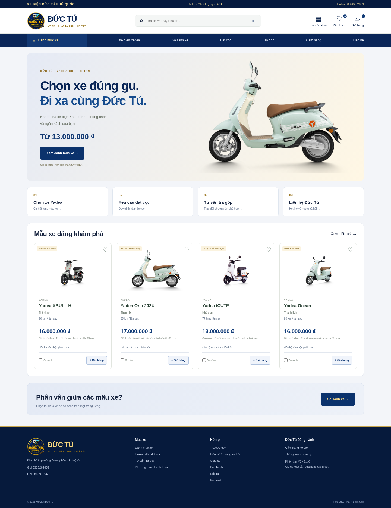

# Xe Điện Đức Tú — V2 nhiều trang (2.3.0)

Website bán xe điện Yadea cho Đức Tú Phú Quốc, dùng Node.js 24 + SQLite tích hợp. Không cần npm install, không có thư viện ngoài. Giao diện navy/vàng sử dụng logo do chủ cửa hàng cung cấp.

## Chạy trên Windows bằng VS Code hoặc trực tiếp

1. Cài Node.js 24.
2. Giải nén mã nguồn vào thư mục riêng. Nếu website cũ đang chạy, dừng cửa sổ đó trước.
3. Nhấp đúp `XEM-WEBSITE.cmd`.
4. Nhập mật khẩu quản trị tự chọn, tối thiểu 16 ký tự. Ký tự không hiển thị khi gõ, không được ghi vào file hay log. Ghi nhớ mật khẩu cho phiên chạy này.
5. Giữ cửa sổ mở và truy cập `http://localhost:3000` trên chính máy đó. Đăng nhập quản trị tại `/admin` bằng mật khẩu vừa chọn.

Mỗi lần chạy lại, nhập mật khẩu của bạn. Không mở trực tiếp index.html hoặc dùng Live Server vì các trang và API cần máy chủ Node.js. Nếu báo cổng bị sử dụng, dừng đúng cửa sổ website cũ; không kết thúc tiến trình khác tùy tiện.

Hoặc chạy trong Terminal:

```sh
npm run preview
```

Chạy không tương tác / trên VPS: cung cấp ADMIN_PASSWORD bằng biến môi trường bảo mật rồi dùng `npm start`. PORT mặc định 3000, SITE_URL phải khớp origin trình duyệt. Khi đổi PORT, đổi SITE_URL tương ứng.

## Các trang và chức năng

| Đường dẫn | Chức năng |
|---|---|
| `/` | Trang chủ và xe gợi ý, dẫn đến các trang chức năng |
| `/xe-dien` | Danh mục, tìm kiếm, lọc kiểu xe / ngân sách, sắp xếp, phân trang |
| `/xe/ID/ten-xe` | Trang riêng từng xe: ảnh, mô tả, thông số, đặt xe, đặt cọc, trả góp |
| `/gio-hang` | Chỉnh số lượng, xóa xe, xem tổng tiền |
| `/dat-hang` | Thông tin nhận xe, phương án mua và đồng ý xử lý dữ liệu |
| `/dat-hang/hoan-tat` | Mã yêu cầu đã được lưu; chưa xác nhận giao xe / đã trả tiền |
| `/dat-coc` | Quy trình đặt cọc và chọn xe để gửi yêu cầu |
| `/tra-gop` | Yêu cầu tư vấn xe, kỳ hạn và tiền trả trước mong muốn |
| `/thanh-toan` | Giải thích thanh toán khi nhận xe, đặt cọc, trạng thái cổng online |
| `/tra-cuu` | Tra cứu bằng mã đơn + điện thoại, gồm trạng thái và tiền đã ghi nhận |
| `/dang-nhap` / `/dang-ky` | Tài khoản email/mật khẩu; các nút mạng xã hội chờ app thật |
| `/tai-khoan` | Thông tin cá nhân, đổi mật khẩu và đơn gửi khi đăng nhập |
| `/tra-cuu-tu-van` | Tra cứu phản hồi tư vấn bằng mã yêu cầu + số điện thoại |
| `/yeu-thich` | Danh sách xe quan tâm, lưu trên trình duyệt |
| `/so-sanh` | So sánh tối đa 3 xe trên trang riêng |
| `/lien-he` | Hotline, link Zalo / Facebook / Messenger / TikTok và form tư vấn |
| `/cam-nang` | Danh sách hướng dẫn, mỗi bài có đường dẫn riêng |
| `/chinh-sach/*` | Các trang giao xe, đổi trả, bảo hành, bảo mật |

Danh mục và chi tiết được tạo HTML tại máy chủ, xem được ngay cả khi tắt JavaScript. Giỏ hàng, yêu thích, so sánh và gửi biểu mẫu cần JavaScript. Link chi tiết cũ `?product=ID` được chuyển đến trang xe tương ứng.

## Quản trị theo từng trang

- `/admin`: tổng quan.
- `/admin/san-pham`: giá, danh mục, mô tả, thông số, ảnh chính + tối đa 8 ảnh thêm, nguồn ảnh và tồn kho.
- `/admin/don-hang`: thông tin đơn, phương án mua, trạng thái, số tiền cửa hàng ghi nhận; xuất CSV tối đa 500 đơn gần nhất.
- `/admin/tu-van`: hộp thư tìm kiếm/lọc; xem yêu cầu thường / trả góp; lưu trạng thái, ghi chú nội bộ và bản nháp; đăng phản hồi trên website; mở cuộc gọi hoặc Zalo để liên hệ thủ công.
- `/admin/thanh-toan`: sổ ghi nhận thu / hoàn tiền theo chứng từ đã được nhân viên kiểm tra.
- `/admin/cai-dat`: thông tin cửa hàng, link mạng xã hội, mức cọc và các chính sách.

Sản phẩm và cài đặt có thanh **Lưu thay đổi** cố định trên cùng và thông báo thời điểm lưu. Khi sửa xe, thông tin vẫn giữ trong biểu mẫu sau khi lưu; tạo xe mới trả lại ID để lưu tiếp không nhân bản sản phẩm. Đơn hàng phải bấm **Lưu trạng thái**, chọn danh sách không tự ghi dữ liệu. Thay đổi chưa lưu sẽ được cảnh báo trước khi rời trang.

Hộp thư và tổng quan cập nhật mỗi 30 giây khi trang đang mở và không có chỉnh sửa chưa lưu. Khách nhận mã sau khi gửi tư vấn, rồi xem phản hồi tại `/tra-cuu-tu-van`. **Lưu nháp** không đăng nội dung; **Đăng phản hồi cho khách** lưu lịch sử công khai riêng cho mã + điện thoại đó. Ghi chú nội bộ, bản nháp và thông tin cá nhân không được trả về API tra cứu. Phản hồi chống trùng theo khóa gửi, giữ lại sau khi khởi động lại. Chưa có thông báo đẩy, SMS/email/Zalo tự động; khách cần mở trang tra cứu hoặc nhân viên liên hệ thủ công.

Một tài khoản quản trị, phiên 8 giờ, cookie HttpOnly/SameSite; phiên mất khi máy chủ khởi động lại. Mật khẩu lấy từ môi trường, không có mật khẩu mặc định trong mã nguồn.

## Đặt hàng, đặt cọc và trả góp thực tế

Yêu cầu đặt xe được lưu vào SQLite và xuất hiện ở trang quản trị. Cửa hàng cần kiểm tra đơn mới và liên hệ xác nhận giá, phiên bản, phí giao. Website không tự gửi Zalo, Messenger, SMS hoặc email.

- Khi nhận xe: gửi yêu cầu, cửa hàng xác nhận rồi thỏa thuận thanh toán / giao xe.
- Đặt cọc: chưa đặt mức tiền mặc định vì chủ cửa hàng chưa cung cấp. Quản trị nhập mức cọc đề xuất và điều kiện hoàn/hủy. Backend tính mức cọc từ cấu hình, không tin số tiền do trình duyệt gửi. Nếu mức cọc bằng 0, lưu yêu cầu nhưng chờ xác nhận số tiền.
- Trả góp: ghi nhận nhu cầu và kỳ hạn mong muốn. Chưa có đơn vị tài chính / lãi suất được xác nhận, không quảng cáo 0%, tính khoản trả tháng hoặc tự duyệt hồ sơ.
- Thanh toán online: chủ cửa hàng xác nhận chưa có tài khoản merchant. Hiện chưa tích hợp VNPay/MoMo hoặc thu tiền qua cổng. Lựa chọn online bị khóa và API không nhận phương án không được hỗ trợ. Muốn bật cần chọn nhà cung cấp, có tài khoản merchant, khóa qua kênh bảo mật, HTTPS, callback/IPN xác thực, đối soát, hoàn tiền và thử giao dịch trước khi vận hành.

Các ghi nhận thu/hoàn hiện là thao tác của nhân viên **sau khi kiểm tra chứng từ**, không phải bằng chứng từ ngân hàng hay cổng thanh toán. API quản trị yêu cầu phiên và CSRF; không thể đổi trạng thái tiền qua query string hoặc dữ liệu khách gửi. Ghi nhận có mã chống trùng, chặn khoản thu vượt tổng, hoàn vượt tiền đã ghi nhận và hủy đơn còn tiền chưa hoàn.

Khi nhập tồn kho thật, hệ thống giữ xe lúc tiếp nhận yêu cầu và hoàn tồn khi hủy. Tồn kho để trống nghĩa là cần cửa hàng xác nhận. Đơn giao/hủy không mở lại; hủy lặp không hoàn kho hai lần. Chủ cửa hàng cần xử lý yêu cầu tồn đọng để tránh giữ xe quá lâu.

## Mạng xã hội và ảnh thật Yadea

Hai hotline do chủ cửa hàng cung cấp: **0326 262 859**, **0866 975 540**. Địa chỉ khu vực: Khu phố 6, phường Dương Đông, Phú Quốc. Điền địa chỉ đường cụ thể và tên pháp lý khi có thông tin chính thức.

Chủ cửa hàng chưa cung cấp URL Zalo/Facebook/Messenger/TikTok: các mục chưa có URL hiển thị “Chưa cập nhật”, không gán tài khoản giả. Điền link HTTPS chính thức tại `/admin/cai-dat`; backend kiểm tra đúng hostname từng dịch vụ. Đây là liên kết mở kênh tư vấn, không phải bot gửi tin hoặc tích hợp API mạng xã hội.

**Đã tải ảnh sản phẩm chính thức từ website YADEA**, qua tuyến proxy hỗ trợ và kiểm tra HTTP 200. Danh mục V2 sử dụng XBULL H, Orla 2024, iCUTE, Ocean, Vigor 2025 và i8; có thêm ảnh màu cho Orla, iCUTE, Ocean, Vigor. Mỗi xe có permalink nguồn; `catalog/yadea.json` ghi URL ảnh, tiêu đề nguồn, SHA-256 và thời điểm tải. File gốc giữ nguyên, không dùng AI sửa ảnh xe. Ảnh lấy từ website chính thức, không tự đăng nhập Facebook/TikTok.

Giữ các mức giá đề xuất 13/16/17 triệu theo yêu cầu chủ cửa hàng; ảnh và thông số hãng không chứng minh giá bán này. Thông số được đối chiếu trang sản phẩm, có chú thích điều kiện thử nghiệm và phiên bản. Vigor có hai loại ắc quy nên hiển thị khoảng 60–70 km thay vì tự chọn một giá trị. Khi nâng cấp, chỉ thay mẫu demo nguyên trạng chưa được đặt hàng; giữ các ảnh, giá, mô tả đã chỉnh và đơn cũ.

Các miền `yadea.com.vn`, `*.yadea.com.vn`, `www.facebook.com` đã được lưu trong bản nháp cấu hình môi trường; native Node dùng `--use-env-proxy` để kiểm tra nguồn. Không cần kết nối mạng hãng để hiển thị ảnh đã đóng gói sẵn.

Có hai cách thay ảnh:

1. Tải ảnh xe đã xác nhận từ bài đăng Yadea về máy, vào quản trị Sản phẩm, chọn ảnh chính / bộ ảnh, điền permalink nguồn và lưu. Không thể tự lấy Facebook/TikTok khi cần đăng nhập hoặc bị chặn truy cập.
2. Nhập ảnh từ trang sản phẩm chính thức Yadea, nếu máy có quyền truy cập:

```sh
npm run import:yadea -- "Orla" "URL-TRANG-SAN-PHAM-YADEA"
# Sau khi kiểm tra nguồn và đúng phiên bản:
npm run import:yadea -- "Orla" "URL-TRANG-SAN-PHAM-YADEA" --apply
```

Helper mặc định chỉ kiểm tra, giới hạn HTTPS thuộc yadea.com.vn, kiểm tra tiêu đề có tên mẫu, không tải logo hoặc trang sai mẫu, không tắt TLS. Chỉ nhận PNG/JPEG/WebP ≤2 MB, lưu SHA-256 và nguồn trong `data/image-sources.jsonl`. `--apply` cập nhật ảnh cho đúng sản phẩm, giữ giá và đơn hàng. Parser/validation và một lần tải thử Orla từ nguồn thật đã được kiểm tra; bộ ảnh đóng gói đã đối chiếu từng trang và checksum. Helper không hỗ trợ tự đăng nhập mạng xã hội.

Giá 13/16/17 triệu là mức chủ cửa hàng đề xuất, chưa phải báo giá chính thức Yadea. Các thông số tham khảo từ hãng cần đối chiếu đúng phiên bản đang bán; thông số chưa rõ hiển thị “Đang cập nhật”. Poster giảm 500 nghìn–2 triệu chưa được áp dụng vì thiếu thời hạn và xe áp dụng.

## Triển khai tên miền / VPS

VPS Linux cần Docker Engine + Docker Compose plugin. Có tên miền và quyền sửa DNS:

1. Đưa mã nguồn lên VPS. Trỏ A đến IPv4 VPS; chỉ thêm AAAA nếu có IPv6 hoạt động. Mở TCP 80/443. Không công bố port 3000 ra Internet.
2. Copy `.env.example` thành `.env`, đặt DOMAIN (hostname, không https/path) và ADMIN_PASSWORD ngẫu nhiên ≥16 ký tự. Giữ `.env` chỉ chủ máy đọc (`chmod 600 .env`); không commit hoặc gửi khóa trong chat.
3. Chạy `docker compose up -d --build`. Caddy tự cấp/gia hạn HTTPS khi DNS và cổng đúng.
4. Kiểm tra `docker compose ps`, `docker compose logs --tail=100 app caddy` và HTTP 200 ở `/api/health` trên miền thật.
5. Điền thông tin cửa hàng, các mạng xã hội, chính sách, giá/thông số và ảnh thật. Gửi đơn thử, tra cứu, kiểm tra trong quản trị, hủy đơn thử.

V2 hiện chưa được triển khai tên miền trong Codex vì chưa có VPS/tên miền. Chưa kiểm tra giao dịch cổng online vì chưa có merchant. Không gọi bản này đã thu tiền online.

## Sao lưu / khôi phục

Dữ liệu và ảnh ở `data/` hoặc DATA_DIR, bị Git bỏ qua. Docker dùng volume `store_data`; không chạy `docker compose down -v` vì sẽ xóa dữ liệu.

SQLite đang chạy cần backup cả WAL qua API, không copy riêng DB:

```sh
mkdir -p backups
chmod 700 backups
docker compose exec -T app node -e "const {DatabaseSync}=require('node:sqlite');const db=new DatabaseSync('/app/data/store.sqlite');db.exec(\"VACUUM INTO '/app/data/backup.sqlite'\");db.close()"
docker compose cp app:/app/data/backup.sqlite ./backups/store.sqlite
docker compose cp app:/app/data/media ./backups/media
docker compose exec -T app node -e "require('node:fs').unlinkSync('/app/data/backup.sqlite')"
chmod 600 backups/store.sqlite
```

Nếu đã nhập ảnh từ helper, sao lưu thêm `image-sources.jsonl`. Chuyển backup đến nơi riêng có kiểm soát truy cập, không vào Git. Dừng app trước khi phục hồi DB vào volume `/app/data/store.sqlite` (UID/GID node 1000), phục hồi media, dọn WAL/SHM cũ của DB được thay thế rồi khởi động. Kiểm tra sản phẩm, đơn, sổ thu/hoàn. Thực hành phục hồi ở môi trường riêng trước khi cần dùng.

## Kiểm thử và giới hạn

```sh
npm test
```

5 kiểm thử tích hợp/validation hiện bao phủ: xác thực/CSRF, upload raster, lưu đơn và dữ liệu sau khởi động lại, giữ/hoàn tồn, chống trùng, nguồn ảnh, các trang riêng, escaping HTML, yêu cầu cọc/trả góp, ghi nhận thu/hoàn và quyền truy cập, không giả thanh toán thành công, checksum ảnh chính thức và giữ nguyên đơn / sản phẩm đã được đặt trước nâng cấp.

Luồng trình duyệt đã kiểm tra trên desktop và 390px: SSR không JavaScript, trang xe riêng, bộ lọc, giỏ hàng, yêu thích/so sánh, đặt cọc, xác nhận tiếp nhận, tra cứu, tư vấn trả góp, quản trị từng trang, CSV, ghi nhận khoản thu và trạng thái công khai. Không có lỗi JavaScript.

Một phiên bản app / một DB SQLite. Rate limit theo địa chỉ kết nối; khi qua Caddy, khách có thể chia sẻ hạn mức. Danh sách quản trị tối đa 500 mục gần nhất. Đã có tài khoản khách hàng email/mật khẩu. Chưa có xác minh/khôi phục email, thông báo tự động, hãng vận chuyển, cổng thanh toán hoặc đối tác trả góp. Các khả năng đó cần dịch vụ/tài khoản thật và kiểm thử riêng, không thể coi là tương đương toàn bộ hệ thống CellphoneS/TGDD.

## Ảnh chụp các trang V2



[Danh mục](docs/screenshots/v2-catalog.png) · [Trang riêng xe](docs/screenshots/v2-product.png) · [Giỏ hàng](docs/screenshots/v2-cart.png) · [Đặt xe / cọc](docs/screenshots/v2-checkout.png) · [Trả góp](docs/screenshots/v2-installment.png) · [Liên hệ](docs/screenshots/v2-contact.png) · [Điện thoại](docs/screenshots/v2-mobile.png) · [Quản trị sản phẩm](docs/screenshots/v2-admin-products.png)

Ảnh chụp giao diện với danh mục mặc định, biểu mẫu khách hàng trống, không có mật khẩu hoặc thông tin khách hàng thật.

## Quản trị V2.2

Ảnh giao diện trong `docs/screenshots/v22-admin-*.png`. Hộp thư dùng dữ liệu minh họa ở DB kiểm thử riêng, đã ẩn số điện thoại. Kiểm thử V2.2 bổ sung: lưu xe/cài đặt rồi tải lại; phản hồi tư vấn, bản nháp riêng tư, chống gửi trùng, truy cập sai số điện thoại, dữ liệu sau restart; desktop và màn hình 390px.

## V2.3: quay lại quản trị, danh mục và tài khoản

- **Xem cửa hàng** ở admin mở tab mới. Cửa hàng hiện **Quay lại quản trị** nếu cookie quản trị còn hiệu lực. Khách chưa đăng nhập admin không thấy thanh này; quyền truy cập API vẫn được kiểm tra riêng.
- Nút ☰ ở admin thu gọn/mở menu; trạng thái lưu trong trình duyệt. Danh mục storefront mở menu kiểu xe + ngân sách, đóng bằng Escape hoặc bấm bên ngoài. Bộ lọc ở `/xe-dien` cũng thu gọn được.
- Khách đăng ký email/mật khẩu tối thiểu 10 ký tự, đăng nhập, đăng xuất, cập nhật tên/điện thoại, đổi mật khẩu hiện tại. Mật khẩu dùng scrypt với salt riêng; cookie phiên HttpOnly, Secure khi production; phiên khách 7 ngày trong SQLite, độc lập phiên admin. Đổi mật khẩu hủy các phiên khác.
- Lịch sử chỉ lấy đơn gửi khi đã đăng nhập, gắn bằng customer_id tại máy chủ. Không tự gán đơn cũ theo email/số điện thoại chưa xác minh. Khách vẫn đặt đơn không tài khoản và tra cứu bằng mã + điện thoại.
- Chưa có dịch vụ gửi thư: email chưa xác minh, chưa có quên mật khẩu qua email. Không tự đặt lại mật khẩu dựa vào một yêu cầu điện thoại.

### Kết nối Google / Facebook / Zalo khi có ứng dụng

Chủ cửa hàng xác nhận **chưa có app**, nên mặc định cả ba nút hiện **Chờ cấu hình**. Có bộ xử lý OAuth phía máy chủ, state gắn với cookie trình duyệt, hết hạn 5 phút/chỉ dùng một lần; Google/Zalo dùng PKCE. Không tự liên kết tài khoản xã hội với tài khoản email. Access token chỉ dùng để lấy định danh, không lưu xuống DB hoặc đưa ra trình duyệt.

| Nhà cung cấp | Biến cấu hình trên máy chủ | Callback đăng ký chính xác |
|---|---|---|
| Google (Gmail) | GOOGLE_CLIENT_ID, GOOGLE_CLIENT_SECRET | https://TEN-MIEN/api/auth/social/google/callback |
| Facebook | FACEBOOK_CLIENT_ID, FACEBOOK_CLIENT_SECRET | https://TEN-MIEN/api/auth/social/facebook/callback |
| Zalo | ZALO_APP_ID, ZALO_APP_SECRET | https://TEN-MIEN/api/auth/social/zalo/callback |

Tạo ứng dụng tại nhà cung cấp, điền tên miền/HTTPS callback và hoàn tất yêu cầu xét duyệt theo tài khoản ứng dụng. Nhập cấu hình trong `.env` bảo mật ở VPS (không commit hoặc gửi chat); Compose đã truyền các biến này. Khởi động lại app sau khi đổi. Nút chỉ bật khi đủ ID + secret. Với Google dùng OAuth web client (OpenID Connect), Facebook Graph v23.0 public_profile, Zalo OAuth v4 + profile v2.0.

**Chưa xác minh đăng nhập thật với nhà cung cấp** vì chưa có app/khóa và tên miền. Kiểm thử OAuth hiện dùng nhà cung cấp mô phỏng để kiểm tra state, cookie, token exchange, PKCE và chặn replay. Trước khi công bố kênh thật, phải thử đăng nhập/đăng xuất, hủy cấp quyền và callback trên app chính thức; việc có khóa không tự chứng minh app đã được nhà cung cấp cho phép dùng công khai.

Kiểm tra V2.3: `npm test` chạy 8 bài; kiểm tra trình duyệt desktop/390px đăng ký, đăng nhập, sửa hồ sơ, lịch sử đơn, menu, tab cửa hàng và quay lại admin. Ảnh trong `docs/screenshots/v23-*` là danh mục công khai và biểu mẫu trống. Khi cập nhật từ ZIP, dừng app cũ, sao lưu thư mục `data` rồi giữ nguyên dữ liệu đó trong bản mới trước khi chạy; không chạy hai server cùng DB.
